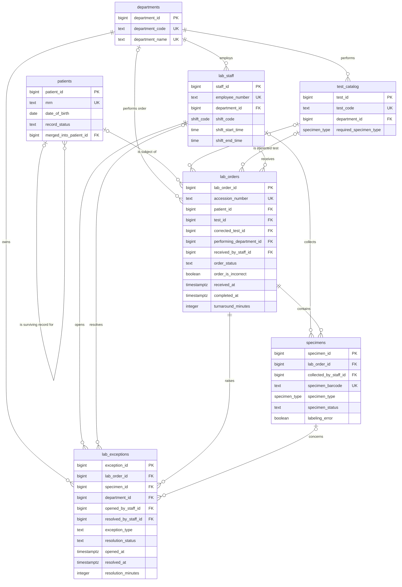

# Entity relationship diagram

The diagram shows the seven tables in the `clinical_lab` schema. A crow's foot is "many." A circle means that side is optional. The data dictionary lists every column and constraint.

## How to read the optional links

- An order has one patient, except an incomplete or rejected order may have none.
- An order has one ordered test, except while it is incomplete. The corrected test is set only when that ordered test was wrong.
- The performing department is required once a test is set, and it must be the department stored on that test.
- Receipt staff may be missing. The receipt shift is required once the order has been received.
- A specimen has one collector or none. Naming a collector requires the collection shift.
- An exception always has an order, a department, and the employee who opened it. The resolver is set only when the exception is resolved.
- Specimen type, labeling, and rejection exceptions must name a specimen. The other exception types may name one.

## Relationships the diagram cannot draw

`lab_exceptions (specimen_id, lab_order_id)` references `specimens (specimen_id, lab_order_id)`. A specimen-level exception cannot point at a specimen from a different order. If `specimen_id` is null, PostgreSQL skips that check.

`lab_orders (test_id, performing_department_id)` references `test_catalog (test_id, department_id)`. The department on the order cannot disagree with the catalog.

`patients.merged_into_patient_id` references another patient, never the same row. A merged row points at the surviving record. One surviving patient can absorb many duplicates.

Every foreign key uses `ON DELETE RESTRICT`. A parent row that still has children cannot be deleted.
